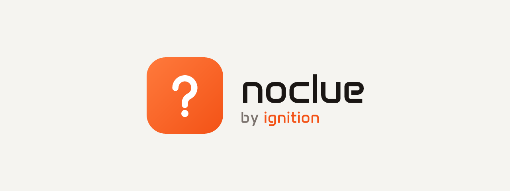

<p align="center">
  
</p>

<p align="center"><strong>Short, calm answers for your Google Meet and Microsoft Teams calls, based on your own facts.</strong></p>

noclue is a Chrome extension. It listens to the other people in your meeting tab, notices when
someone asks you something, and shows a short answer you can say in your own words. Answers
come from the project facts and profile you add, and every factual sentence is checked against
them before it is shown.

There is no noclue account and no noclue server. You use your own OpenAI key (and optionally
your own Anthropic key), so you pay the AI provider directly and only for what you use.

> **Status:** public beta (0.4.0). English meetings only. Chrome desktop with Google Meet or
> Microsoft Teams on the web.

## Install

1. Install **noclue by ignition** from the Chrome Web Store.
   _Until the listing is live: download `noclue-<version>.zip` from
   [Releases](../../releases), unzip it, open `chrome://extensions`, turn on Developer mode,
   choose **Load unpacked** and select the unzipped folder._
2. The setup guide opens. Paste your OpenAI API key, test your microphone and read where your
   data goes. It takes about three minutes.
3. Open a meeting in Chrome, click the noclue icon in the toolbar, add a few project facts and
   choose **Start Listening**.

### Getting API keys

| Provider  | Needed for                                         | Where                                                                              |
| --------- | -------------------------------------------------- | ---------------------------------------------------------------------------------- |
| OpenAI    | Always: live transcription, and answers by default | [platform.openai.com/api-keys](https://platform.openai.com/api-keys)               |
| Anthropic | Optional: answers and the fact check by Claude     | [console.anthropic.com/settings/keys](https://console.anthropic.com/settings/keys) |

Create a separate key for noclue and set a monthly spending limit in your provider account.
**Test keys** in the extension is free: it only reads model details.

### What it costs

You pay your provider's current API prices. The cost grows with how long other people speak
(transcription) and how many answers you ask for (each answer is written and then
fact-checked). See [OpenAI pricing](https://openai.com/api/pricing/) and
[Anthropic pricing](https://www.anthropic.com/pricing#api).

## Using it in a meeting

- **Headphones** help noclue tell your voice from the meeting. Your microphone never leaves your
  computer. It only tells noclue when you are speaking, so automatic answers wait for you.
- **Answer Now** asks for an answer immediately, even while you speak.
- **Show cue window** opens a small movable window over the meeting. Hide it before you share
  your screen.
- **Stop** ends listening and clears the transcript. Closing the panel alone keeps listening.
- **Try a practice question** shows how your facts support an answer, without recording audio.
- **Stick to my knowledge** limits answers to your facts. Turned off, general questions can be
  answered from general knowledge, but project and personal claims still need your facts.

## Privacy

- Meeting audio from the selected tab goes to OpenAI for live transcription while you listen.
  It is never stored on disk.
- Your project facts, profile and the recent transcript go to OpenAI or Anthropic, whichever you
  choose, to prepare and check answers. OpenAI requests use `store: false`.
- Keys, project and settings stay in this Chrome profile (`chrome.storage.local`, not synced).
  Chrome does not encrypt extension storage.
- noclue has no server and no analytics. Nothing is sent anywhere else.
- Recording or transcribing other people may need their consent where you live. Tell
  participants when the rules or the situation call for it.

Full policy: [PRIVACY.md](PRIVACY.md).

## Limits

- English meetings only. Speaker names are not recognised.
- Chrome desktop only. The Teams desktop app cannot be captured: open the meeting in Chrome.
- noclue cannot see whether you are muted, whether a question was meant for you, or what you
  already said. Answers are only as good as the facts you add.

## Development

```bash
nvm use
npm install
npm run build
```

Load `apps/extension/dist` as an unpacked extension. Tests, architecture and release steps are in
[docs/DEVELOPMENT.md](docs/DEVELOPMENT.md). Contributions are welcome, see
[CONTRIBUTING.md](CONTRIBUTING.md). A Slovak overview is in [docs/sk/README.md](docs/sk/README.md).

## License

Code: [MIT](LICENSE). The names noclue and ignition and their logos are not covered by the MIT
license. Third-party components: [NOTICES.md](NOTICES.md).
